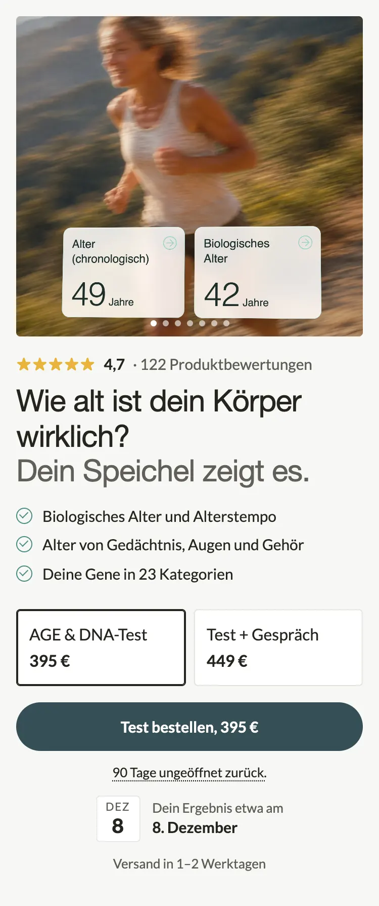

# 01 Hero und Kaufzone (`main`, `lt-pdp-hero`): Impeccable-Durchgang 2 (28.10.2026)

Zweiter `/impeccable`-Durchgang (critique, bolder, delight) auf dem Hero der AGE&DNA-Verkaufsseite, Ausgang Commit `3c3d766`. **BJ 28.10.2026:** Variante „Test + Ergebnisgespräch“ im Shopify-Admin von 449 auf 495 € gesetzt; **Streichpreise beider Varianten in Shopify gelöscht** (vorher 449 und 549 €, `compare_at` jetzt leer, gilt auch für Merchant Center und Meta-Katalog). **Kein Streichpreis und kein Chip „Du sparst“ auf der Seite**, deshalb `pkg_chip_compare` und `compact_post_row` im Template aus; die Schalter bleiben im Liquid für später. Die Karten lesen den Preis aus der Variante, Vorschau und Bild zeigen 495 € ohne Chip. Ziel: Der erste Bildschirm auf dem Handy sagt in einem Blick, was man bekommt, was es kostet und warum man jetzt bestellt. Nicht committet, nicht gepusht.

- Vorschau: `docs/agedna-pdp-impeccable-2/01-hero.html` (http://localhost:8789/agedna-pdp-impeccable-2/01-hero.html), Basis-CSS aus der Gesamtvorschau, Texte wie im Template.
- Bilder bei 375 px, zweifach: `01-hero-vorher.webp` (Stand 27.10., identisch mit `agedna-pdp-impeccable/nachher/nachher-01.webp`) und `01-hero-nachher.webp`.
- Geändert: `sections/lt-pdp-hero.liquid` und der Block `main` in `templates/product.age-dna-test.json`. NMN-PDP rendert unverändert (alle neuen Schalter per Default aus, Bildhöhe per Default 92 %).

## Befund (Critique)

Zwei getrennte Gutachten: A (Designkritik aus Bild, Liquid und Template-Block, Nielsen 21 von 32) und B (Detektor `detect.mjs`, 52 Advisory-Befunde, alle Token-Abweichungen aus DESIGN.md wie 4-px-Radien und 13/15-px-Schriften, keine Anti-Muster; der URL-Scan brach ab, weil Puppeteer im Skill-Ordner fehlt).

1. **Garantie und Ergebnistermin lagen unter der Falz.** Knopf-Unterkante bei 797 px von 812, darunter Garantiezeile (809), Kalenderblatt (841 bis 887), Versand (899). Das „oder was“ des Angebots und der stärkste gestaltete Moment waren im ersten Blick nicht da.
2. **Unter der H1 hatte fast alles dasselbe Gewicht.** Bullets, Kartennamen, Kartenpreise, Garantie, Versand: 13 bis 15 px in Ink oder Grau. Der Preis war mit 15 px die kleinste Zahl im Hero, nur der Knopf trug ihn groß.
3. **Der Chip „Du sparst“ fehlte** (BJ-Regel), bewusst wegen der Kollision Streichpreis 449 € gegen Karte 2 mit damals 449 €.
4. **Drei Zeilen in drei Ausrichtungen unter dem Knopf**: Garantie zentriert, Blatt als Gruppe zentriert mit linksbündigem Text, Versand zentriert.
5. **Das Bild trägt sein Gewicht nicht ganz.** 316 px hoch, die Pointe (49 gegen 42) sitzt im unteren Drittel, die Karussellpunkte der Vorschau schnitten die Karten an. „Beispielwerte“ steht nur im Alt-Text.
6. **Bullets ohne Anker**: drei gleichrangige Nominalphrasen, „23 Kategorien“ als Zahl ohne Kopf.
7. **Paketkarten im echten Theme untereinander**, jede eine Zeile mit Radio. Die Vorschau vom 27.10. zeigte sie nebeneinander, das Theme nicht.

## Änderungen (bolder)

Die eine entschiedene Bewegung: **Preis und Absicherung in den ersten Blick, Zahl vor Text.** Alles andere wird nur leiser. (Chip und Chip-Zeile sind gebaut, aber auf BJs Ansage vom 28.10. abgeschaltet, siehe oben.)

- **Bild mobil 80 % statt 92 % der Breite** (`compact_gallery_ratio: 80`, Zuschnitt sichtbar 8 bis 88 % der Höhe, Gesicht und beide App-Karten bleiben). Spart 42 px.
- **Bullets mit Kopf** (`hero_bullet_lead`, Schreibweise „Kopf | Rest“): **Biologisches Alter** und Alterstempo · **Gedächtnis, Augen, Gehör** mit eigenem Alter · **23 Kategorien** deiner Gene. Gleiche Fakten, der Kopf steht fett in Ink, der Rest grau.
- **Paketkarten nebeneinander** (`pkg_cards_row`): Name oben in 14 px, Preis darunter in Abschnittsgröße (20 px, Überschrift-Schrift, Tabellenziffern), gewählte Karte fett in Ink, die andere grau. Kein Radio-Kreis, die Auswahl trägt der Rahmen. Nur Name und Preis (BJ-Regel).
- **Unter dem Knopf nur die Garantie** „90 Tage ungeöffnet zurück.“ (öffnet weiter das Popup), darunter das Kalenderblatt. Gebaut, aber aus: Chip „Du sparst“ aus dem Streichpreis der gewählten Karte (`pkg_chip_compare`) und Chip plus Garantie in einer Zeile (`compact_post_row`).
- **Versandzeile wandert ins Kalenderblatt**: Zeile 1 „Versand in 1–2 Werktagen“, Zeile 2 „Dein Ergebnis etwa am **9. Dezember**“. Versand und Ergebnis sind eine Strecke, eine Zeile weniger. Die Zeile unter dem Blatt rendert nicht mehr, wenn sie leer wäre.
- Überschrift, Unterzeile, Sterne, Knopf-Label, Garantietext: unverändert.

## Delight (geschärft)

**Abreißblatt statt Einblenden.** Das Kalenderblatt zeigt erst den heutigen Tag („Okt 28“) und reißt nach 0,9 s in 0,55 s nach oben ab, darunter steht der Ergebnistag („Dez 9“). Aus „etwa sechs Wochen“ wird eine Spanne ab heute, das ist die Information, die der Moment trägt. Einziger bewegter Moment der Section.

- Bei `prefers-reduced-motion` liegt das obere Blatt nie auf, der Ergebnistag steht sofort.
- Ohne JavaScript rendert Liquid den Ergebnistag (heute plus `result_line_days`, deutsche Monatsnamen) direkt ins Blatt und in den Text; das obere Blatt bleibt weg. Mit JavaScript wird das Datum im Browser neu gerechnet, weil die Seite aus dem Cache kommt.
- Geprüft in der Vorschau per Puppeteer: normal (Blatt sichtbar, nach 2 s Opacity 0), reduzierte Bewegung (Blatt `display: none`), ohne JavaScript (Serverdatum steht, Blatt weg).

## Neue Schalter in `lt-pdp-hero.liquid` (alle per Default aus bzw. wie bisher)

| Setting | Typ | Default | AGE&DNA |
|---|---|---|---|
| `compact_gallery_ratio` | range 70 bis 100 % | 92 | 80 |
| `hero_bullet_lead` | checkbox | false | true |
| `pkg_cards_row` | checkbox | false | true |
| `pkg_chip_compare` | checkbox | false | false (gebaut, BJ 28.10.: kein Chip) |
| `compact_post_row` | checkbox | false | false (ohne Chip nicht nötig) |

`result_line_style: blatt` ist in der Darstellung geändert (Abreißblatt, Versand im Blatt, Serverdatum ohne JavaScript); den Wert nutzt nur das AGE&DNA-Template. Die Pfade `zeile` und die NMN-Kaufzone sind unberührt.

## Höhen bei 375 px (Vorschau, Kopfzeile 56 px)

| | Vorher | Nachher |
|---|---|---|
| Section | 894 px | 816 px |
| Bild | 316 px | 274 px |
| Knopf-Unterkante | 797 px | 758 px |
| Garantie | 809 bis 829 px | 770 bis 789 px, im ersten Bildschirm |
| Kalenderblatt | 841 bis 887 px | 793 bis 840 px (Versandzeile noch im ersten Bildschirm) |
| Versandzeile | 899 bis 918 px | im Blatt |

Kein horizontales Scrollen bei 375 px (Dokumentbreite 375). Bei 1280 px zwei Spalten, Bild links quadratisch, Kaufzone rechts, Garantie und Blatt unter dem Knopf. `shopify theme check`: für `lt-pdp-hero.liquid` nur die bekannte AssetPreload-Warnung (Zeile 164, Bestand), Template ohne Befund. Alle Settings des Blocks `main` haben einen Schema-Eintrag.

| Vorher | Nachher |
|---|---|
|  |  |

## Offene Fragen für BJ

1. **Streichpreise erledigt.** Auf der Seite waren sie unsichtbar, in Shopify sind sie seit 28.10. gelöscht. Rollback: Variante „Test“ `compare_at` 449,00 €, Variante „Test + Ergebnisgespräch“ 549,00 €.
2. **Notiz der zweiten Karte.** „45 Minuten per Video. Du gehst mit drei Punkten raus.“ erscheint erst beim Antippen (`pkg_note_selected_only`) und schiebt den Knopf um rund 36 px. Vor dem Antippen weiß die Kundin nicht, was die 100 € mehr bringen. Alternativen: Notiz immer zeigen (kostet die 36 px dauerhaft), kürzen auf „45 Min Video“ oder in den Einwänden erklären.
3. **Kein Vertrauenssignal im ersten Bildschirm** außer den Sternen. Labor und Limmroth stehen in der Belege-Section direkt darunter. Eine Zeile `trust_1` („Leitung: Prof. Dr. med. Volker Limmroth“) kostet rund 20 px und würde das Blatt ganz unter die Falz schieben.
4. **Bildzuschnitt 80 %.** Oben wird ein schmaler Streifen Haar angeschnitten. Mit 84 % bleibt er, dann rutschen Chip und Garantie auf 784 bis 811 px, also gerade noch in den ersten Bildschirm. Schalter im Theme-Editor.
5. **Liquid-Datum ungerendert geprüft.** Die Serverseite rechnet `'now' | date: '%s' | plus: Sekunden | date: '%-d'` und `'%m'`; das ist das übliche Muster für Lieferdaten in Shopify-Themes, aber hier nicht auf dem Dev-Theme gerendert (kein zweites `theme dev` neben den parallelen Sitzungen). Vor dem Push einmal im Vorschau-Theme mit abgeschaltetem JavaScript ansehen.
6. **„Beispielwerte“** steht nur im Alt-Text, nicht im Bild. Das Bild wird hier nicht neu erzeugt.

Nicht gebaut, wie vorgegeben: Hero-Zahlen einzählen, Sophie K. 60 auf 58, Summe im Bonus-Stack, neue Farben oder Schriften.
