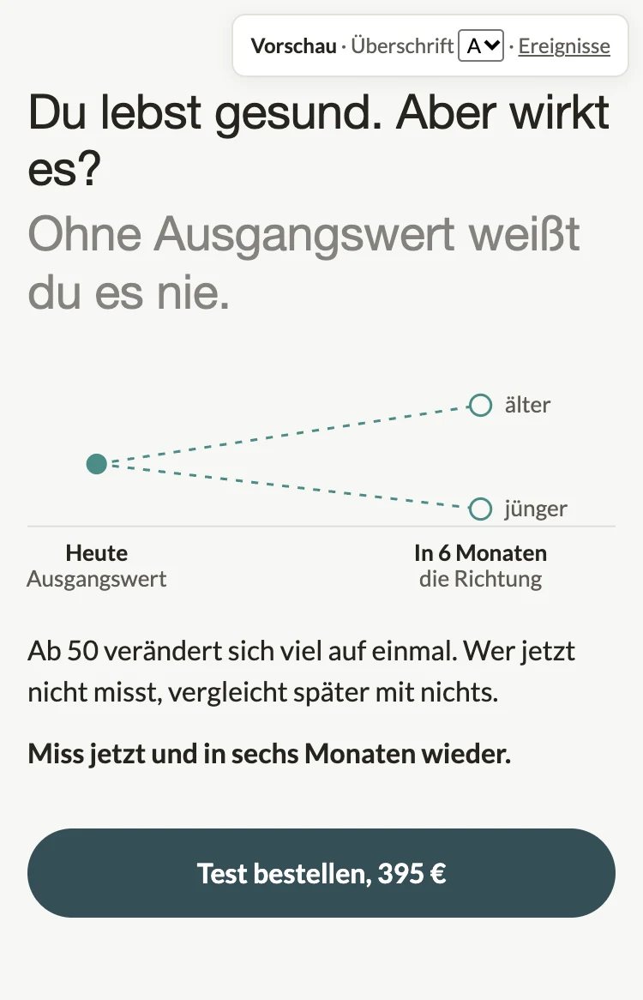
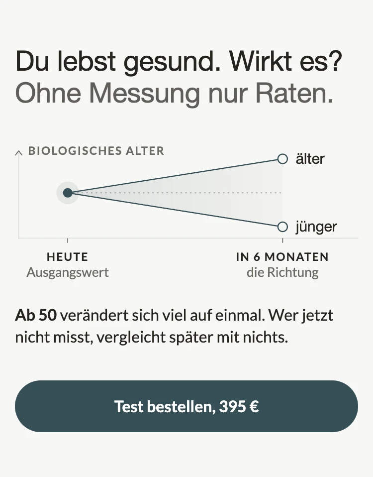
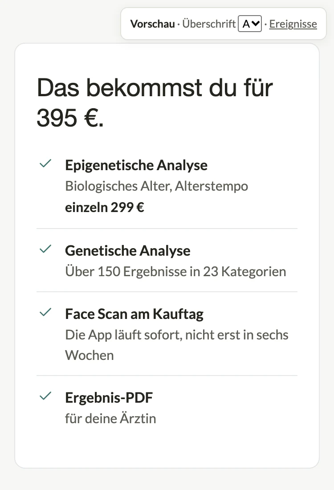
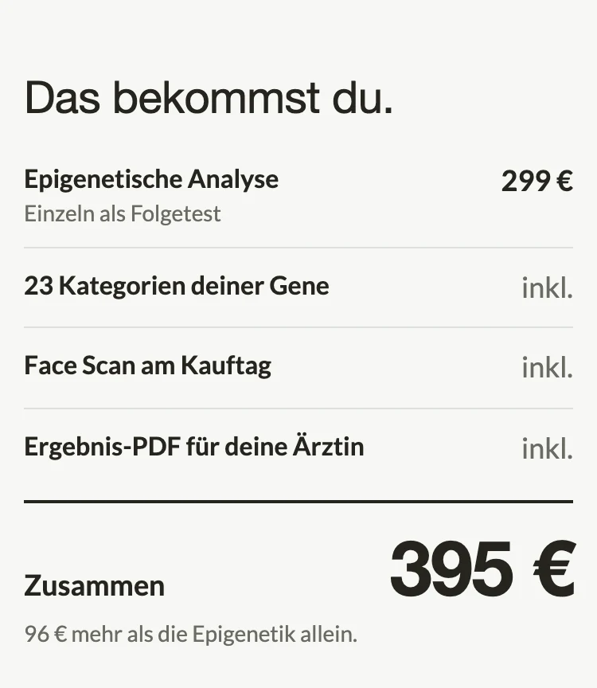
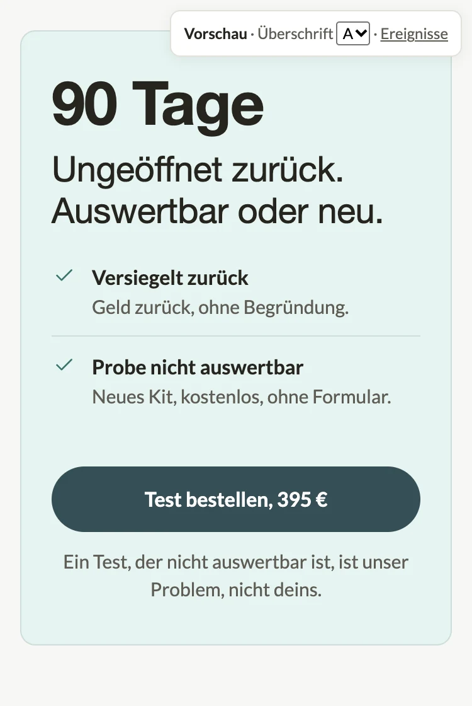
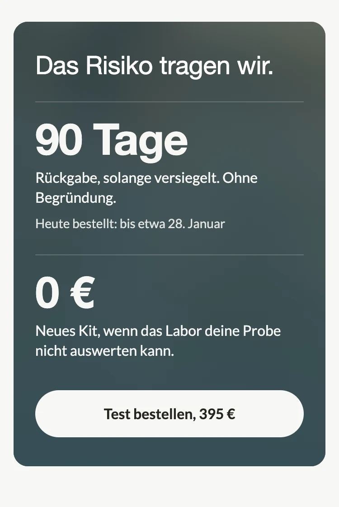
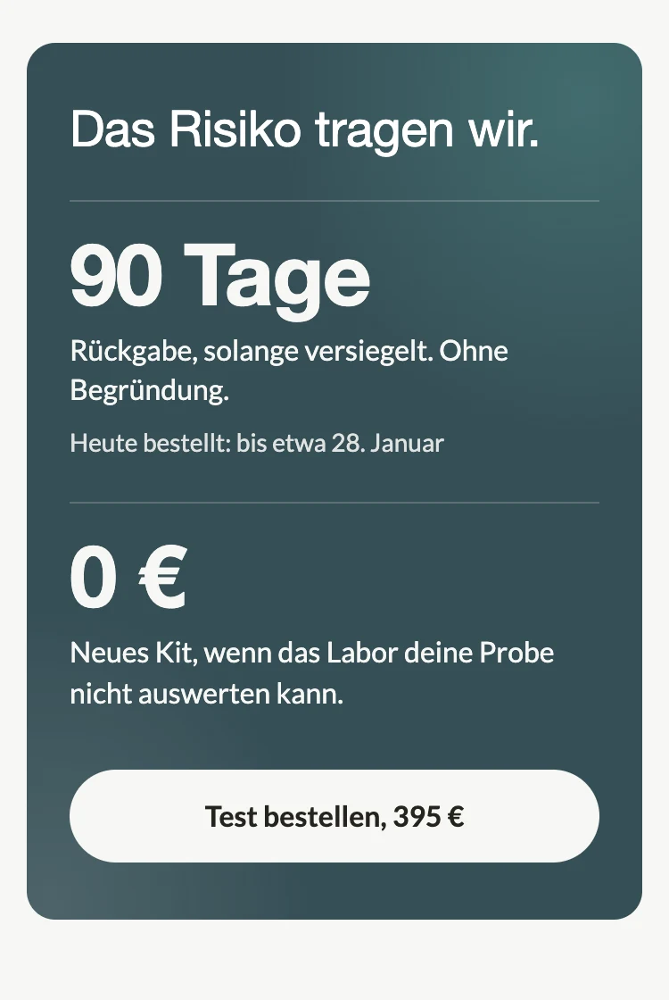

# Impeccable 2: Zusage-Sections (Warum jetzt, Bonus-Stack, Garantie), 28.10.2026

Zweiter `/impeccable`-Durchgang (critique, bolder, delight) für die drei Instanzen von `sections/lt-pdp-zusage.liquid` auf der AGE&DNA-PDP (`templates/product.age-dna-test.json`, Keys `warum_jetzt`, `bonus_stack`, `garantie`). Nicht committet, nicht gepusht.

- Vorschau: `docs/agedna-pdp-impeccable-2/03-zusage.html` (http://localhost:8789/agedna-pdp-impeccable-2/03-zusage.html), nur die drei Sections in Template-Reihenfolge, Texte 1:1 aus dem Template, Section-CSS wörtlich aus dem Liquid.
- Vorschau mit dem Live-Rand von 15 px unter 475 px Breite (vorher 20). Bilder bei 375 px, zweifach: `03-zusage-vorher-1.webp` bis `-3` (aus der Gesamtvorschau vom 27.10.) und `03-zusage-nachher-1.webp` bis `-3`.
- Critique-Snapshot: `.impeccable/critique/2026-10-28T05-52-07Z__sections-lt-pdp-zusage-liquid.md` (Dual-Agent, 19/32, ein P0, zwei P1).

| Section | Vorher | Nachher | Höhe 375 px |
|---|---|---|---|
| 3 Warum jetzt |  |  | 584 → 479 |
| 10 Bonus-Stack |  |  | 549 → 491 → 432 (Durchgang 3) |
| 11 Garantie |  |  | 560 → 538 → 560 (Durchgang 3, Foto) |

Die Nachher-Bilder 2 und 3 zeigen den Stand nach Durchgang 3 (unten), Bild 1 den nach Durchgang 2. Die Mesh-Variante der Garantie: 

## Critique (Kurzfassung)

Gutachten A (Designkritik) und B (Detector, Browser-Overlay) getrennt. B fand im Liquid nur die 13 px im SVG-Text (jetzt Token), das Knopf-Padding war ein Fehlalarm (min-height 52 px per Flex). A:

- **Garantie, P0:** „90 Tage“ stand als 48-px-Zahl über beiden Stufen, gilt aber nur für die versiegelte Rücksendung. Die Überschrift wiederholte die Hero-Zeile, „ungeöffnet“ und „versiegelt“ standen für dieselbe Bedingung, der beste Satz („unser Problem, nicht deins“) war 14-px-Kleingedrucktes unter dem Knopf.
- **Warum jetzt, P1:** dieselbe Aussage dreimal (Unterzeile, Absatz, fetter Schlusssatz), Ein-Wort-Witwe „es?“ in der Überschrift, „älter“ oben rechts las sich zuerst als Fortschritt, weil die Achse nicht beschriftet war.
- **Bonus-Stack, P1/P2:** der einzige belegte Vergleich (299 €) stand 14 px grau als dritte Zeile; die Karte wiederholte die Analysen aus den Belegen, statt den Preis zu zeigen; weiße Karte und Mint-Karte lagen als zwei gleiche Objekte übereinander.

## 3 Warum jetzt (`warum_jetzt`)

**Bolder:** ein Argument, ein Bild. Überschrift und Unterzeile gekürzt, je eine Zeile mobil (BJ 28.10.): „Du lebst gesund. Wirkt es?“ und „Ohne Messung nur Raten.“ (vorher „Du lebst gesund. Aber wirkt es?“ und „Ohne Ausgangswert weißt du es nie.“, zusammen vier Zeilen). Gemessen in Helvetica Neue 28 px: 330 und 321 px bei 345 px Spaltenbreite (375 px Bildschirm, Live-Rand 15 px); einzeilig von 360 bis 414 px. Die Gabel bleibt, größer (Strich 2 px, Punkte r 7, Enden weiter auseinander) und mit senkrechter Achse „Biologisches Alter“ (`verlauf_axis`), damit oben nicht Fortschritt heißt. Ein Absatz statt zwei: `z_2` mit Zahl zuerst („**Ab 50** verändert sich viel auf einmal. Wer jetzt nicht misst, vergleicht später mit nichts.“), `z_4` („Miss jetzt und in sechs Monaten wieder.“) deaktiviert, das sagt die Grafik.

**Delight:** unverändert die eine Bewegung, die Gabel zeichnet sich einmal von links nach rechts, die Enden erscheinen danach. Ohne JavaScript und bei reduzierter Bewegung steht sie fertig.

**Grafik neu gezeichnet (`/diagram-design`, 28.10.2026, nach BJ-Vorgabe „klar, minimal, medizinisch, Produktgrafik“):** Achsen als Haarlinien, die Wertachse mit kleinem Pfeil und waagerechter Beschriftung „BIOLOGISCHES ALTER“ oben (vorher senkrecht gedreht). Äste als feine durchgezogene Linien (1,25) im dunklen Teal der Seite (`--color-dark`, über 8:1 auf dem Grund) statt gestrichelt im helleren Teal. Gefüllter Punkt mit leichtem Hof = gemessen, Ringe = die zweite Messung, die noch aussteht. Zwischen den Ästen ein Korridor, der nach rechts ausläuft (Teal 14 % → 3 %), er zeigt den Raum der möglichen Ergebnisse. Eine gepunktete Waagerechte auf Höhe des Ausgangswerts macht oben = älter ohne weitere Worte lesbar. Zeitachse mit Strichmarken, Zeiten als kleine Versalien („HEUTE“, „IN 6 MONATEN“), darunter die Zusätze grau. „älter“ und „jünger“ in Helvetica wie die Überschriften. Die Zeichenfläche ist 364 breit, die Grafik skaliert auf die Spaltenbreite und wird dadurch rund 8 % kleiner als 1:1, die Schrift eingeschlossen (BJ 28.10.: kein seitliches Scrollen, lieber kleinere Schrift). Kein Erklärtext unter der Grafik. Eigenständiges Diagramm-Blatt: `03-zusage-verlauf.html` (Self-Check des Skills bestanden).

## 10 Bonus-Stack (`bonus_stack`)

**Bolder:** der Preis als Entscheidung in einem Blick. Neue Zeilenart `posten` (Kassenzettel): Posten links, kurzer Wert rechts, Summenzeile mit dem Preis der Variante (`sum_enable`, nie aus Text), darunter `sum_note`. Nur ein Posten trägt einen Preis (Epigenetische Analyse, „Einzeln als Folgetest“, 299 €), die drei anderen stehen auf „inkl.“, die Summe 395 € in 36 px. Die Zeile „96 € mehr als die Epigenetik allein“ ist die Rechnung aus zwei belegten Preisen, Wortlaut aus `01-angebot.md` § 2 („Die Genetik mit über 150 Ergebnissen kostet dich 96 € mehr“). Keine Summe aus Phantasiewerten. Weiße Karte weg (`card_style: none`): die Garantie ist jetzt die einzige Karte in diesem Lauf. Überschrift „Das bekommst du.“ ohne Preis, der steht einmal, in der Summe.

**Delight:** die drei „inkl.“-Posten stapeln sich beim Hereinscrollen kurz nacheinander auf den ersten, dann schließt die Summe (`stagger_enable`, 0,1 bis 0,6 s). Ohne JavaScript und bei reduzierter Bewegung steht alles.

## 11 Garantie (`garantie`)

**Bolder:** die zwei Stufen aus `01-angebot.md` § 3 als zwei Kacheln (`list_style: stufen`), je Stufe die Zahl zuerst: **90 Tage** „Rückgabe, solange versiegelt. Geld zurück, ohne Begründung.“ und **0 €** „Neues Kit, wenn das Labor deine Probe nicht auswerten kann. Ohne Formular.“ Die Zahl über beiden Stufen (`stat_value`) ist leer, die Überschrift „Das Risiko tragen wir.“ wiederholt weder die Hero-Zeile noch die Stufen, kein Kicker. Wortlaut Stufe 1 nach `docs/garantie-90-tage-2026-10-27.md` („90 Tage Rückgabe, solange versiegelt“), „ungeöffnet“ kommt in dieser Section nicht mehr vor. Getönte Karte bleibt (BJ-Vorgabe). Stufe 2b liegt als dritte Kachel („**100 %** Kaufpreis zurück, wenn auch das zweite Kit nicht auswertbar ist“) deaktiviert bereit. Auf dem Desktop stehen die Kacheln nebeneinander.

**Delight:** unter „90 Tage“ steht die Frist als Datum, „Heute bestellt: bis etwa 28. Januar“ (`date_days: 92`, also 90 Tage ab Erhalt plus zwei Tage Versand, deshalb „etwa“), dasselbe Mittel wie der Ergebnistermin im Hero. Ohne JavaScript bleibt die Zeile weg, es wird nichts eingeblendet.

## Neue Schalter in `lt-pdp-zusage` (alle per Default aus oder leer)

| Schalter | Wirkung |
|---|---|
| `list_style: posten` | Posten-Liste, Wert rechts (kurz: „299 €“, „inkl.“); ein Wert mit „€“ gilt als Preis |
| `sum_enable`, `sum_label`, `sum_note` | Summenzeile mit dem Variantenpreis, Wort links, Zeile darunter |
| `stagger_enable` | Posten ohne Preis stapeln sich beim Hereinscrollen |
| `list_style: stufen` | Kacheln, `lead` als große Zahl (36 px), `text` darunter |
| Block `date_days`, `date_prefix` | Frist als Datum unter einer Kachel (0 = aus, braucht JavaScript) |
| `verlauf_axis` | Beschriftung der senkrechten Achse der Gabel |

Geändert ohne Schalter: die Gabel neu gezeichnet (siehe Abschnitt 3, gleiche Settings); Schema-Default der Überschrift von „Du gehst kein Risiko ein.“ (nur versiegelt wahr) auf „Das Risiko tragen wir.“; SVG-Text auf Tokens (`--text-micro`, `--text-body-sm`, `--text-body`). Das Skript der Section ist jetzt eines für Enthüllen und Datum und wird nur gerendert, wenn ein Schalter es braucht.

## Geprüft

- Template-Settings gegen das Schema (Typen, Select-Werte, Range-Grenzen): sauber. `order` unverändert.
- `shopify theme check` (ganzes Theme, JSON): keine Befunde in `sections/lt-pdp-zusage.liquid` und `templates/product.age-dna-test.json`. Impeccable-Detector auf dem Liquid: sauber (vorher 1 Befund).
- Kein horizontales Scrollen bei 320, 360, 375 und 414 px (Vorschau und Diagramm-Blatt einzeln gemessen). 1280 px: Kacheln zweispaltig, Posten-Liste auf 44 rem, Knopf links.
- Nicht geprüft: die echte Shopify-Darstellung (erst nach Push in ein Vorschau-Theme) und das Zusammenspiel mit Hero und Belegen, die parallel andere Sitzungen umbauen.

## Offene Fragen für BJ

1. **„Einzeln als Folgetest, 299 €“ als Preis für die Epigenetik allein:** Der Folgetest ist das Angebot für Bestandskundinnen. Die Zeile „96 € mehr als die Epigenetik allein“ folgt deinem Satz aus `01-angebot.md` § 2. Wenn du den Vergleich nicht auf der Seite willst, `sum_note` leeren, die Liste trägt sich auch ohne.
2. **Datum unter „90 Tage“:** rechnet heute plus 92 Tage („etwa“). Soll es 90 ab Bestelltag sein, `date_days: 90`; soll es weg, `date_days: 0`.
3. **Stufe 2b** („100 % Kaufpreis zurück, wenn auch das zweite Kit nicht auswertbar ist“) liegt deaktiviert bereit, Ausfallquote laut Angebotsbrief noch zu erfragen. Mit drei Kacheln wird die Garantie mobil rund 120 px höher.
4. **Knopf im Bonus-Stack:** bewusst keiner (die Seite hat schon vier plus Sticky). Wer nach der Summe kaufen will, findet den Knopf direkt darunter in der Garantie.
5. **Hero sagt „90 Tage ungeöffnet zurück.“, diese Section „solange versiegelt“, die Schluss-Leiste „solange versiegelt“.** Ein Wort für die Hülle auf der ganzen Seite wäre sauberer; „versiegelt“ ist das prüfbare.

## Durchgang 3 (28.10.2026): bolder für Bonus-Stack und Garantie, Garantie-Karte mit Hintergrund

BJ hatte die Gesamtvorschau gesehen und wollte beide Sections noch einmal schärfer (mehr Hierarchie, Zahl vor Text, weniger Zeilen, in einem Blick) und die Garantie-Karte nicht mehr nur getönt, sondern mit einem verwischten Foto oder einem Mesh-Verlauf. Beides als Schalter in `lt-pdp-zusage.liquid`, in der Teilvorschau beide Varianten untereinander, ins Template die Foto-Variante. `warum_jetzt` unverändert (479 px, byte-gleich gerendert).

**Befund (bolder):** Der Bonus-Stack hatte vier gleich schwere Posten mit je einer zweizeiligen Unterzeile, der Weg zur Summe lief über fünf Zeilen Erklärtext; der Posten mit Preis sah aus wie die drei „inkl.“-Posten. In der Garantie schlugen die Zahlen (36 px) die Überschrift (28 px regular) nur knapp, und jede Kachel trug zwei Sätze; die getönte Mint-Karte las sich als zweite helle Fläche auf hellem Grund, kein Gipfel im Scroll.

**Bonus-Stack:** ein Posten je Zeile. Nur der Preis-Posten behält eine Unterzeile („Einzeln als Folgetest“, die Begründung für 299 €), die drei „inkl.“-Posten stehen einzeilig: „23 Kategorien deiner Gene“ (Zahl zuerst, Wortlaut des Hero-Bullets, ersetzt „Genetische Analyse / Über 150 Ergebnisse in 23 Kategorien“), „Face Scan am Kauftag“, „Ergebnis-PDF für deine Ärztin“. Die Summe steht in Display-Größe (48 px, `zahl_xl`), die Zeile „96 € mehr als die Epigenetik allein.“ bleibt. Höhe 491 → 432 px bei 375 px. Die Erklärungen zu Analysen und App tragen Belege und FAQ. Kein Knopf, wie gehabt.

**Garantie:** Zahlen in Display-Größe (48 px, `zahl_xl`), ein Satz je Stufe: **90 Tage** „Rückgabe, solange versiegelt. Ohne Begründung.“ (vorher mit „Geld zurück“ als drittem Satzteil) und **0 €** „Neues Kit, wenn das Labor deine Probe nicht auswerten kann.“ (ohne „Ohne Formular.“). Datum unter 90 Tage bleibt der eine Delight. Die Karte ist jetzt dunkel (Teal `--color-dark`), Text in Paper, der Knopf eine Paper-Pille mit Tintentext wie in der Schlussleiste. Höhe 538 → 560 px (die größeren Zahlen).

**Zwei Hintergründe zur Auswahl (Vorschau, Variante A ist im Template):**

- **A, `card_style: foto`:** das Schlussleisten-Foto (`shopify://shop_images/lt-hp-leiste-schluss.webp`, dieselbe Datei wie in `schluss`), über `card_image` gewählt, per CSS verwischt (Blur 26 px wie `lt-leiste`), Ausschnitt oben rechts, wo das Abendlicht sitzt, darüber Teal von 0,8 (oben) bis voll (unten). Das Foto gibt nur einen warmen Lichthauch am Kopf der Karte, der Rest ist Teal. Kein neues Bild. Ohne gewähltes Bild bleibt die Karte einfarbig Teal.
- **B, `card_style: mesh`:** zwei Radialverläufe auf Teal, Mint 0,26 oben rechts und Paper 0,12 unten links, nichts bewegt sich, keine Farbwerte außerhalb der Palette.

**Kontrast gemessen** (Text ausgeblendet, hellster Pixel im Textkasten gegen die Textfarbe, 375 und 1280 px): Foto 6,4 bis 8,1:1, Mesh 5,8 bis 8,1:1, kleinster Wert die Datumszeile 14 px mit 6,55:1 (Foto, mobil). Nebentext auf dunklen Karten in Paper 0,88 statt 0,72, weil 0,72 auf den aufgehellten Stellen rechnerisch unter 4,5:1 fiele. Knopf: Tinte auf Paper 14,3:1.

**Neue Schalter in `lt-pdp-zusage` (Default aus oder leer):**

| Schalter | Wirkung |
|---|---|
| `card_style: foto` + `card_image` | dunkle Karte mit verwischtem Foto und Teal-Überlagerung |
| `card_style: mesh` | dunkle Karte mit zwei weichen Radialverläufen |
| `zahl_xl` | Summe der Posten-Liste und Zahl der Stufen-Kacheln in 48 px statt 36 |

Beide dunklen Karten setzen die Überschrift per `on_dark` auf den Heading-Stack, Haarlinien in Paper 0,2, Knopf als Paper-Pille. `getoent`, `weiss` und `none` sind unverändert.

**Geprüft:** Template-Settings gegen das Schema (Typen, Select-Werte, Ranges), `order` unverändert. `shopify theme check`: null Befunde in beiden Dateien. 375 und 1280 px ohne Querscroll (scrollWidth = Viewport). Ohne JavaScript: Posten und Summe sichtbar (Opacity 1), Datumszeile bleibt weg; bei reduzierter Bewegung: Endzustand, Datum da. Nicht geprüft: echte Shopify-Darstellung (Foto über `image_url`/`image_tag` wie in `lt-leiste`, erst im Vorschau-Theme sichtbar).

**Offene Fragen für BJ (Durchgang 3):**

1. **Foto oder Mesh?** Im Template steht Foto. Für Mesh: `card_style` auf `mesh`, `card_image` kann stehen bleiben (wird dann nicht gerendert).
2. **Dunkle Karte neben der dunklen Schlussleiste:** zwischen Garantie und Leiste liegt nur die FAQ. Zwei dunkle Flächen nah beieinander sind gewollt (Garantie als Gipfel vor dem Schluss), aber wenn das zu schwer wirkt, trägt die Mesh-Variante weniger Gewicht als das Foto.
3. **„Ohne Formular“** ist aus Stufe 2 gestrichen (ein Satz je Kachel). Wenn der Reibungs-Killer wichtiger ist als die Kürze, wieder anhängen.
4. **„23 Kategorien deiner Gene“** statt „Genetische Analyse“: Wortlaut des Hero-Bullets. Die Zahl 150 Ergebnisse steht damit nur noch in Belegen und FAQ.
