# AGE&DNA-PDP: Impeccable-Durchgang (27.10.2026)

Auftrag: jeden Abschnitt der neuen AGE&DNA-PDP (Commit `837a9b7`) mit `/impeccable` critique, bolder, delight und overdrive so umbauen, dass er **auf dem Handy in einem Blick erfassbar** ist. Lokal committet, **nicht gepusht**.

- Vorschau: `docs/entwurf-agedna-verkaufsseite-impeccable-2026-10-27.html` (http://localhost:8789/entwurf-agedna-verkaufsseite-impeccable-2026-10-27.html). Die Vorgängerin `docs/entwurf-agedna-verkaufsseite-2026-10-27.html` bleibt unverändert.
- Bilder: `docs/agedna-pdp-impeccable/vorher/` und `nachher/`, 375 px, zweifache Auflösung, je Abschnitt ein Bild.
- Ergebnis in Zahlen: Seite **8.988 px → 7.448 px** bei 375 px, also **11,1 → 9,2 Bildschirme**. Der Kaufknopf liegt jetzt im ersten Bildschirm (Unterkante bei rund 795 px von 812).

## Vorgehen

1. **Critique** mit zwei getrennten Gutachten: A (Designkritik aus den Vorher-Bildern, Nielsen 21/36) und B (Detector `detect.mjs`). B fand keine echten Anti-Muster, nur Abweichungen von DESIGN.md (Radien, Schriftgrößen im Hero-CSS, die Serife der Leiste). A fand vor allem Doppelungen: Thomas zweimal, die Abo-Frage zweimal, die Garantie-Vorzeile wiederholt die Überschrift, Leistungen in zwei Abschnitten, drei Kartenlabels in Versalien, Textwände in Belegen und Einwänden.
2. **Bolder** je Abschnitt: Hierarchie, Zahl vor Text, Listen statt Absätze, Rest raus. Keine neuen Farben, keine neue Schrift, Abstände und Größen aus `assets/theme.css`.
3. **Delight** genau einmal auf der Seite: der Ergebnistermin im Hero als Kalenderblatt.
4. **Overdrive** nur zweimal, beide tragen Information: 49 zählt auf 42 (Belege) und die Verlaufsgrafik zeichnet sich (Warum jetzt). Bei reduzierter Bewegung und ohne JavaScript steht jeweils der Endzustand. Die Rückfrage nach Richtungen, die `overdrive` sonst stellt, entfiel: die Richtungen standen im Auftrag (Zahlen, die einzählen; Verlauf-Grafik; sanfte Enthüllung). Sanfte Enthüllung je Abschnitt ist bewusst **nicht** gebaut, sie wäre dieselbe Einblendung überall und damit Dekoration.

Alle neuen Schalter in den Sections stehen per Default aus. NMN-PDP (`lt-pdp-belege`, `lt-pdp-hero`) und die Landingpages `page.dna-lp*.json` (`lt-dna-lp-objections`, `lt-dna-lp-steps`) rendern unverändert.

## Je Abschnitt

### 1 Hero und Kaufzone (`main`, `lt-pdp-hero`) · 1.214 → 894 px

**Befund:** 13 Wörter Überschrift auf fünf Zeilen, Zitat, drei zweizeilige Bullets, zwei gepunktet unterstrichene Zeilen unter dem Knopf. Der Knopf lag unter dem ersten Bildschirm. Das Zitat stammt von einem 46-jährigen Mann, die Zielgruppe sind Frauen von 50 bis 65.

**Änderung:**
- Unterzeile „Deine Speichelprobe zeigt es, in sechs Wochen.“ → „Dein Speichel zeigt es.“ (eine Zeile; die sechs Wochen stehen jetzt als Datum unter dem Knopf)
- Bullets je eine Zeile: „Biologisches Alter und Alterstempo“, „Alter von Gedächtnis, Augen und Gehör“, „Deine Gene in 23 Kategorien“
- Zitat Markus T. raus (`hero_quote` leer), ID-Zeile raus (`trust_4` leer; die Frage steht jetzt als Einwand 3)
- Karte 2: „Test + Gespräch“ statt „Test + Ergebnisgespräch“, beide Karten gleich hoch
- Garantiezeile kurz: „90 Tage ungeöffnet zurück.“ (das Popup erklärt den Rest wie bisher)
- **Delight:** Ergebnistermin als Kalenderblatt (`result_line_style: blatt`): Monat klein, Tag groß, daneben „Dein Ergebnis etwa am 8. Dezember“. Aus „etwa sechs Wochen“ wird ein Tag im Kalender. Blendet einmal weich ein.

| Vorher | Nachher |
|---|---|
| 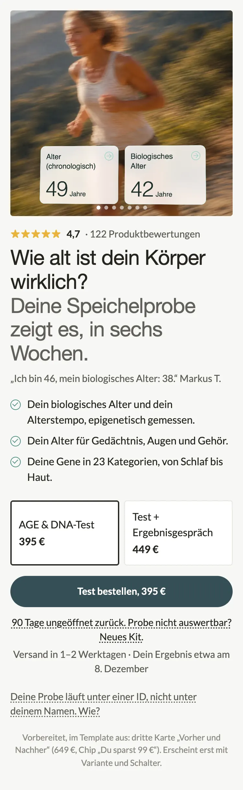 |  |

Hinweis: Das Vorher-Bild zeigt unten eine Vorschau-Notiz zur Stufe 3, die es auf der echten Seite nicht gibt (rund 60 px).

### 2 Beweiszeile und Was du bekommst (`belege`, `lt-pdp-belege`) · 971 → 792 px

**Befund:** Kartenlabel in Versalien, die 42 als Behauptung ohne Kennzeichnung, darunter 100 Wörter in drei Absätzen.

**Änderung:**
- Kartenlabel raus, die Zahl steht oben; Unterzeile „biologisch, 49 laut Pass (Beispiel)“
- **Zahl vor Text** (`labor_text_style: zeilen`, Eingabe „Kopf | Text“): **6 Bereiche** · Epigenetik, misst du nach sechs Monaten neu / **23 Kategorien** · Gene, über 150 Ergebnisse, einmal im Leben / **KI-Coach** · erklärt jeden Wert, PDF für deine Ärztin
- **Overdrive:** 49 zählt beim Hereinscrollen einmal auf 42 (`labor_value_from: 49`), damit der Abstand zum Pass sichtbar wird. Im HTML steht immer 42.
- Beweiszeile gekürzt („Leitung“ statt „Wissenschaftliche Leitung“)

| Vorher | Nachher |
|---|---|
|  | 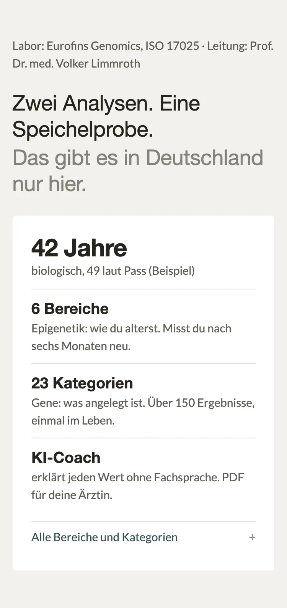 |

### 3 Warum jetzt (`warum_jetzt`, `lt-pdp-zusage`) · 642 → 584 px

**Befund:** vier Absätze. Thomas erzählt dieselbe Geschichte wie in den Stimmen direkt darunter, der Blutbild-Satz steht noch einmal in der Abgrenzung.

**Änderung:**
- Blöcke `z_1` (Blutbild) und `z_3` (Thomas) deaktiviert, Schlusssatz ohne „Dann siehst du die Richtung.“, das zeigt jetzt die Grafik
- **Overdrive, Verlaufsgrafik** (`verlauf_enable`): heute ein Punkt (Ausgangswert), in sechs Monaten zwei mögliche Enden (älter, jünger). Keine Messwerte, nur das Prinzip. Zeichnet sich einmal von links nach rechts.

| Vorher | Nachher |
|---|---|
| 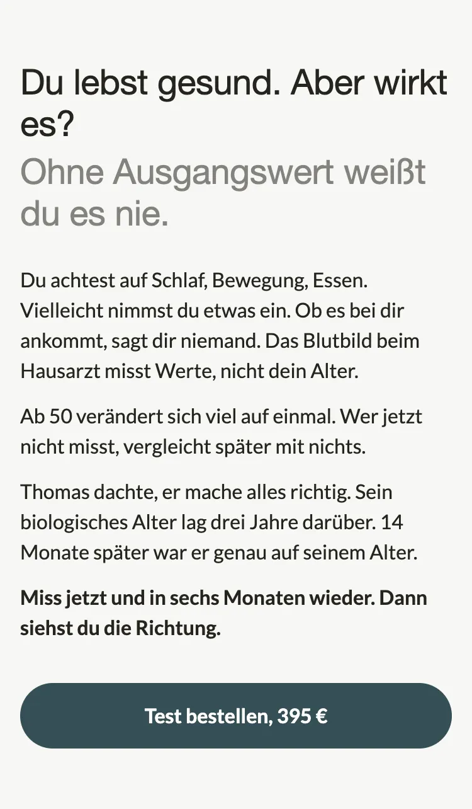 | 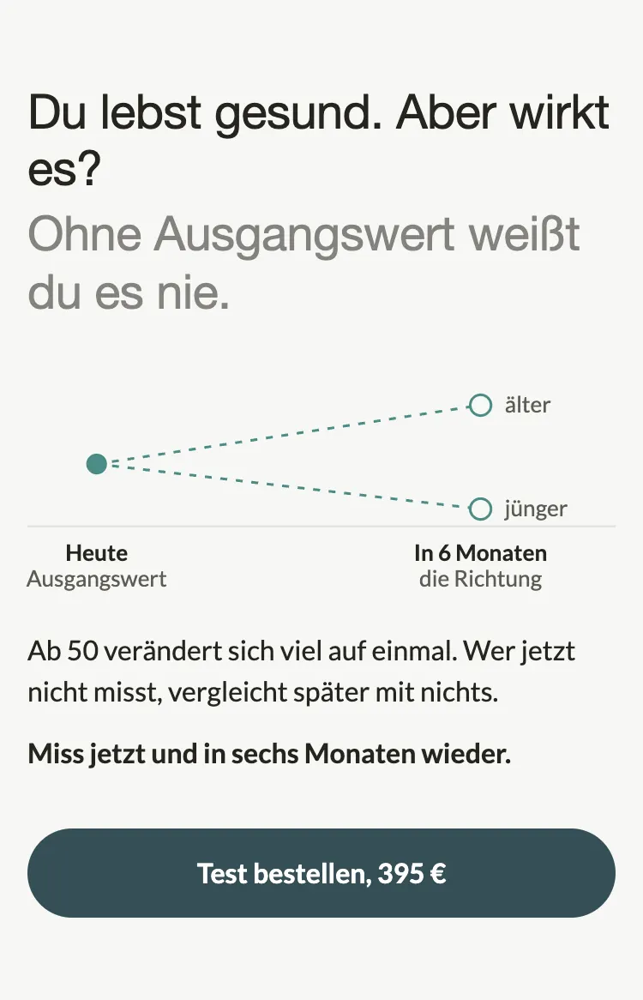 |

### 4 Kundenstimmen (`belege_stimmen`, `lt-pdp-belege`) · 764 → 747 px (mit Loox-Zeile)

**Befund:** Kartenlabel, Schnitt ohne Sterne, die längste Stimme (Thomas, 36 Wörter) zuerst, zwei von drei Stimmen männlich.

**Änderung:** Kartenlabel raus, Sterne neben dem Schnitt (`stimmen_stars_big`), Reihenfolge Sophie K., Petra N., Thomas R. Texte unverändert, sie sind wörtlich aus Loox.

| Vorher | Nachher |
|---|---|
| 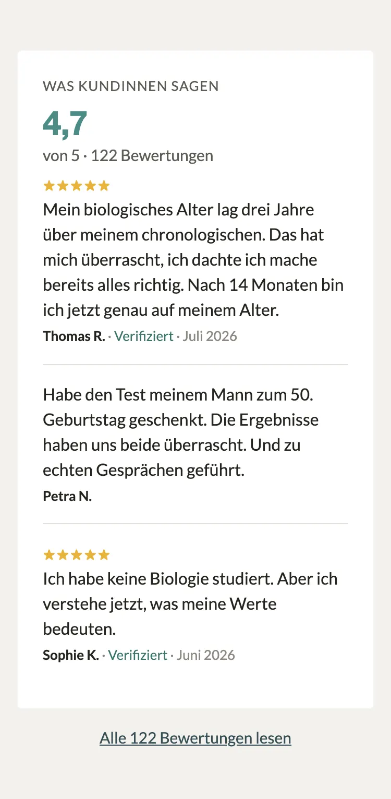 | 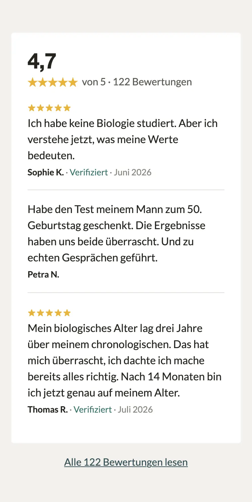 |

### 5 Alle Bewertungen (`loox_reviews`, `lt-pdp-reviews-all`) · unverändert

**Befund:** eine Zeile mit Lade, im Bild unter Abschnitt 4 zu sehen. Erfasst sich bereits in einem Blick. **Änderung:** keine.

### 6 Einwände (`einwaende`, `lt-dna-lp-objections`) · 891 → 593 px

**Befund:** vier Einwände mit je 30 bis 40 Wörtern, die Antwort steckt im zweiten Satz. Die Altersfrage hat mit Kaufhürden wenig zu tun.

**Änderung:**
- **Kurzantwort zuerst, fett** (neuer Block-Wert `kurz`): „Für zwei Analysen.“, „Die Richtung.“, „Das Labor kennt nur eine Nummer.“
- Antworten auf einen bis zwei Sätze gekürzt, „Mit dem Gespräch für 449 € …“ raus
- Altersfrage in die FAQ verschoben, damit drei statt vier
- `read_marker` (`lt_read`) bleibt an dieser Section

| Vorher | Nachher |
|---|---|
| 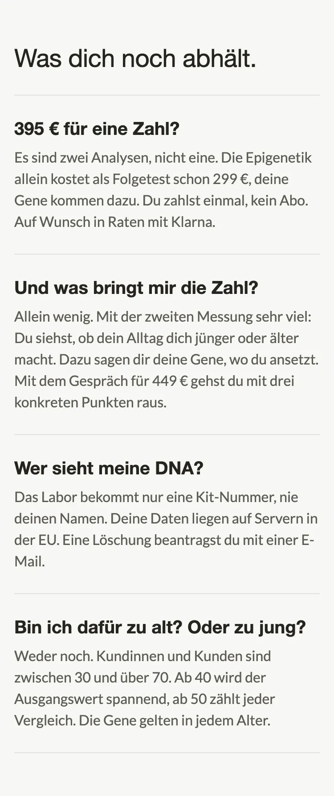 | 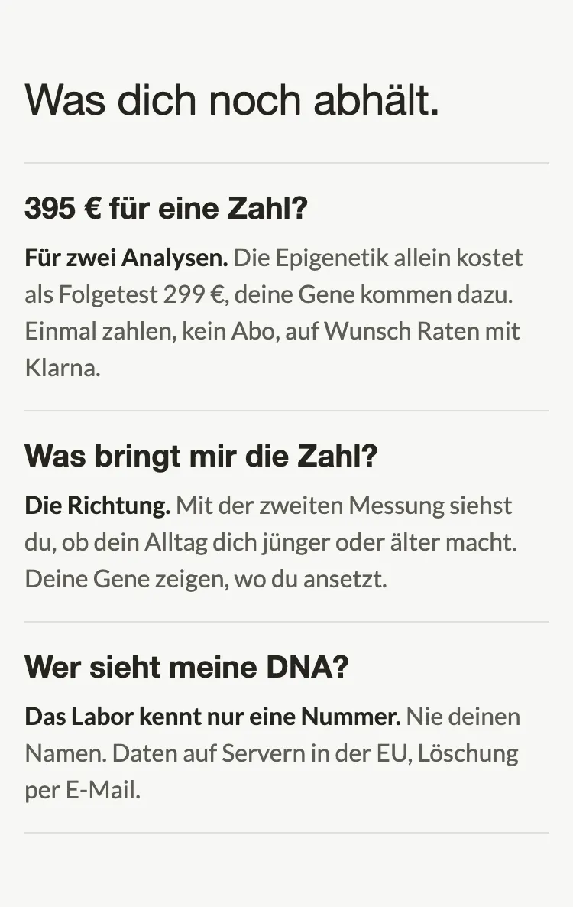 |

### 7 Abgrenzung (`abgrenzung`, `lt-dna-lp-objections`) · 814 → 655 px

**Befund:** fünf gleich gestaltete Zeilen mit großem Titel. Der eigene Test sah aus wie die vier anderen Wege, der Vergleich musste gelesen werden.

**Änderung:** **Raster** (`layout: raster`) mit zwei Spalten **Alter** und **Gene**, Haken oder Strich je Weg. Die eigene Zeile ist getönte Karte mit Vollrahmen (keine farbige Kante). „Rechner und Fragebögen online“ heißt „Online-Rechner“, die Sätze sind kürzer. Die Spaltenwerte folgen den bisherigen Texten: Blutbild, Rechner, Smartwatch messen das Alter nicht; der reine DNA-Test liest Gene; der AGE & DNA-Test beides.

| Vorher | Nachher |
|---|---|
| 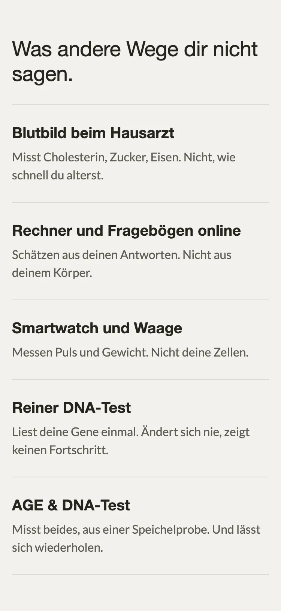 | 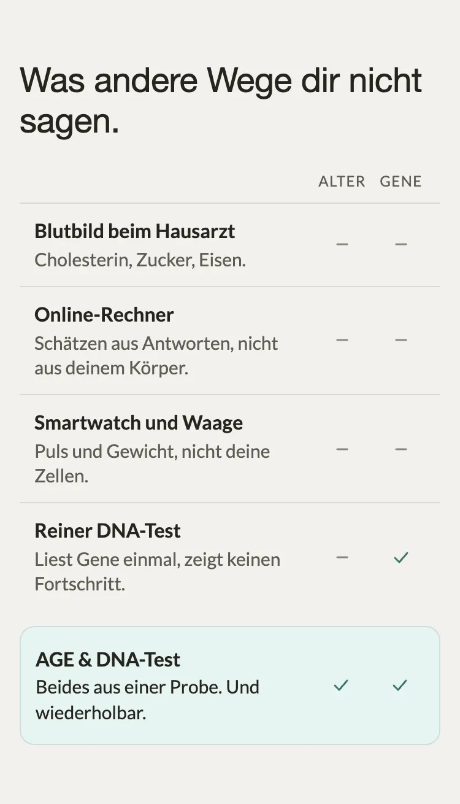 |

### 8 Wissenschaftliche Leitung (`leitung`, `lt-pdp-belege`) · 586 → 424 px

**Befund:** Kartenlabel, ein Absatz mit 36 Wörtern, das Porträt nur 48 px groß. Labor und Name stehen schon in der Beweiszeile.

**Änderung:** Gesicht zuerst und größer (`person_first`, 80 px), Name in Überschrift-Schrift, Rolle „Chefarzt Neurologie, Spiegel-Bestseller-Autor“. Kartenlabel und Absatz raus, die Lade „Wie die Uhr arbeitet“ bleibt.

| Vorher | Nachher |
|---|---|
|  |  |

### 9 Ablauf (`ablauf`, `lt-dna-lp-steps`) · 594 → 602 px

**Befund:** der klarste Abschnitt. Die Schritte standen aber ohne Verbindung untereinander, und in der alten Vorschau saßen die Ziffern neben den Kreisen (Fehler nur in der Vorschau, die Section war richtig).

**Änderung:** **Zeitleiste** (`timeline`): Haarlinie verbindet die Kreise, Schritt 1 „Heute“ gefüllt, Ziffern mit Tabellenziffern. Texte der Schritte 3 bis 5 gekürzt. Auf dem Desktop läuft die Linie waagerecht.

| Vorher | Nachher |
|---|---|
| 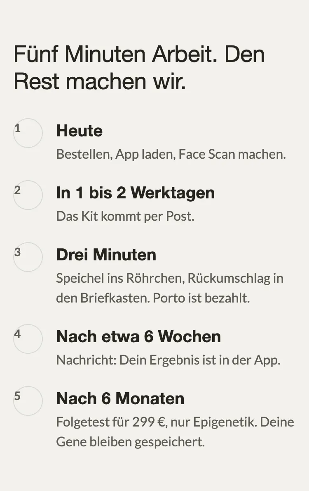 | 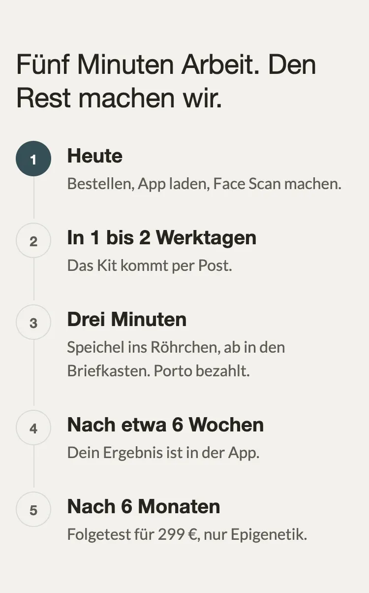 |

### 10 Bonus-Stack (`bonus_stack`, `lt-pdp-zusage`) · 725 → 549 px

**Befund:** Die Wertspalte rechts drückte den Text in eine schmale Spalte, „Epigenetische Analyse: …“ lief über mehrere Zeilen.

**Änderung:** Kopf je Zeile fett in eigener Zeile, ein kurzer Satz darunter, der Wert („einzeln 299 €“) fett unter dem Satz (`lead_own_line`). Doppelpunkte raus.

| Vorher | Nachher |
|---|---|
| 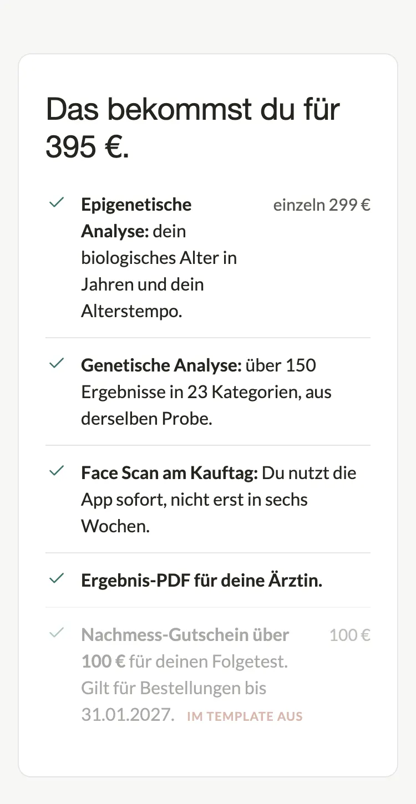 | 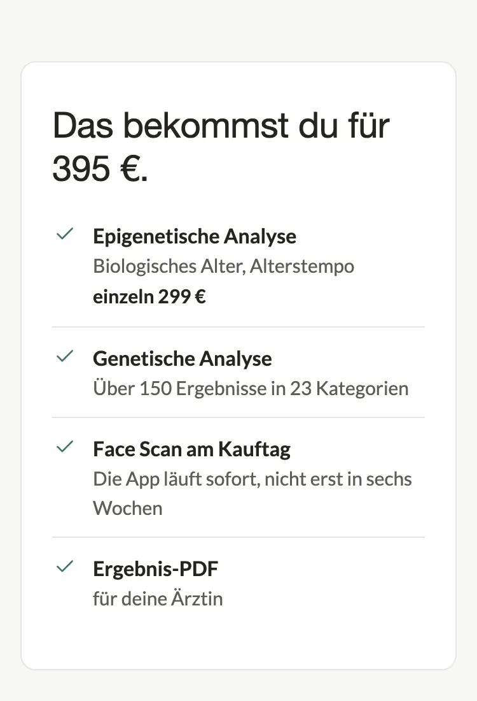 |

### 11 Garantie (`garantie`, `lt-pdp-zusage`) · 738 → 560 px

**Befund:** Die fette Vorzeile wiederholte die Überschrift fast wörtlich, dazu vier Absätze.

**Änderung:** Vorzeile raus, **90 Tage** als große Zahl über der Überschrift (`stat_value`), zwei Zeilen mit Haken („Versiegelt zurück“, „Probe nicht auswertbar“), die Begründung als Zeile unter dem Knopf (`cta_note`). Die getönte Karte bleibt (BJ-Vorgabe: getönte Karte mit Vollrahmen). Stufe 2b bleibt deaktiviert, ist aber schon als Haken-Zeile formuliert.

| Vorher | Nachher |
|---|---|
| 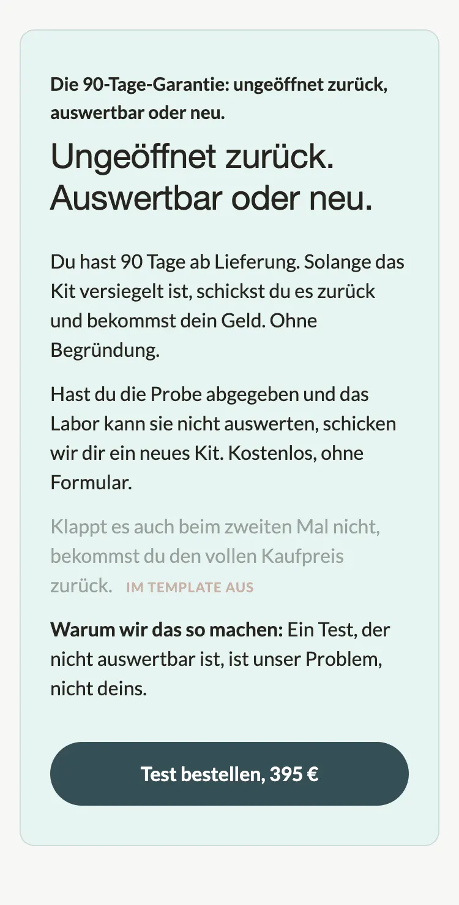 | 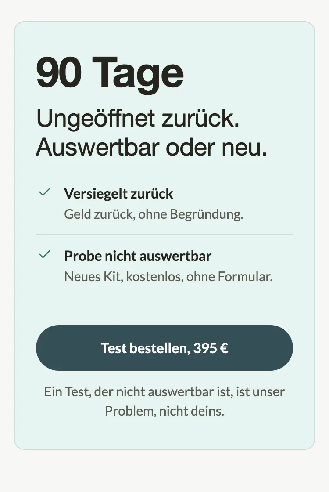 |

### 12 FAQ (`faq_accordion`, `crs-faq-accordion`) · 473 → 473 px

**Befund:** sauber gebaut, aber „Kommen Versand oder ein Abo dazu?“ stand schon im Einwand zum Preis.

**Änderung:** Abo-Frage ersetzt durch die Altersfrage aus den Einwänden (an dritter Stelle), Abstände 80 → 64 px (Theme-Raster `--space-8`). Section-Code unverändert.

| Vorher | Nachher |
|---|---|
| 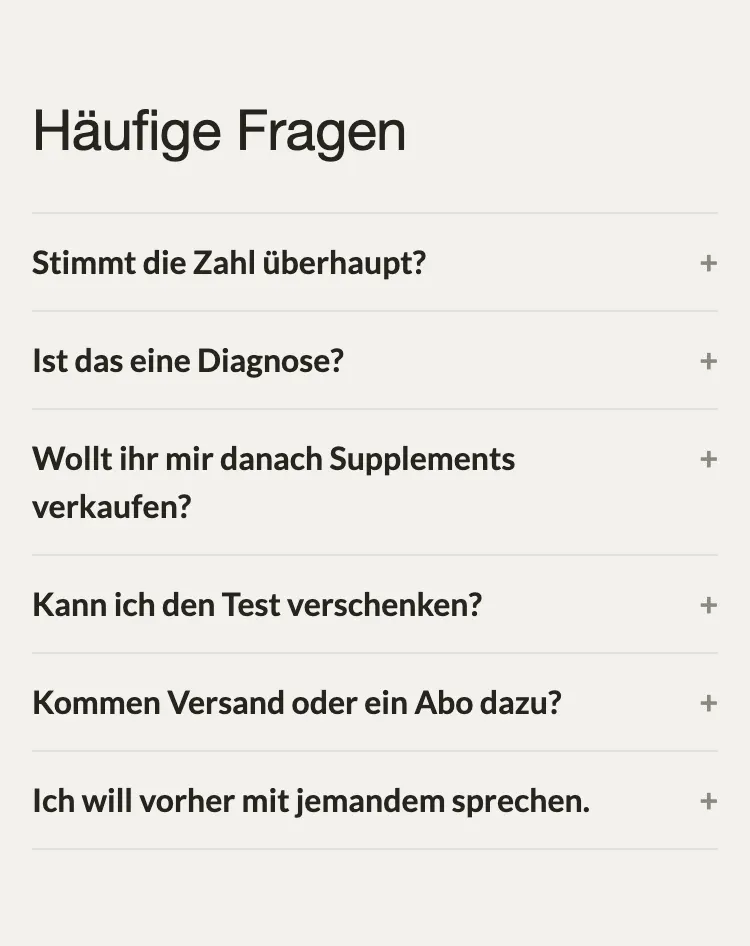 | 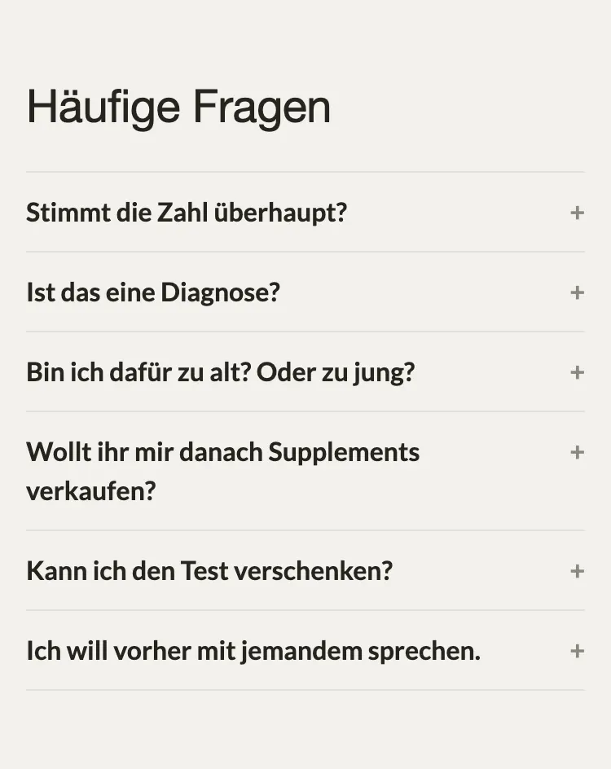 |

### 13 Schluss-Leiste (`schluss`, `lt-leiste`) · unverändert

**Befund:** ein Gedanke, ein Knopf, eine Zeile. Gutachten A schlug vor, Serife und verwischtes Foto zu ersetzen; beides ist das von BJ gewählte Wispr-Muster der Startseite und bleibt. **Änderung:** keine.

| Vorher | Nachher |
|---|---|
|  |  |

### 14 Unsichtbare Produkt-Section (`main_product_hidden`, `main-product`) · unverändert

Deaktiviert, rendert nichts. Bleibt für Shopify-Funktionen im Template.

## Was aus der Critique bewusst nicht umgesetzt ist

| Vorschlag | Warum nicht |
|---|---|
| Einwände ganz streichen | Die Section trägt `lt_read` aus dem Messplan (Grüne Wiese 02 § 5). Stattdessen drei Einwände, Antwort zuerst |
| Belege und Bonus-Stack zusammenlegen | Umbau der Reihenfolge aus 02 § 3, nicht Teil dieses Auftrags. Die Abschnitte sind jetzt verschieden genug: Belege zeigt das Ergebnis, der Stack den Preis |
| Kundenstimme Sophie K. als Zahlenpaar 60 → 58 | Die Zahl steht in PRODUCT.md, aber nicht in Sophies Loox-Bewertung. Ohne Quelle nicht gebaut |
| Summe im Bonus-Stack | Belegt ist nur „einzeln 299 €“. Eine Summe bräuchte weitere echte Einzelpreise |
| Hero-Zahlen einzählen | Verzögert die Zahl, die sofort lesbar sein muss. Gezählt wird erst in Abschnitt 2 |

Nebenbefund aus Gutachten A: PRODUCT.md nennt noch 349 € und 429 €, die Seite zeigt 395 € und 449 €. Nicht angefasst.

## Neue Schalter (alle per Default aus)

| Section | Schalter |
|---|---|
| `lt-pdp-hero` | `result_line_style` (`zeile` / `blatt`) |
| `lt-pdp-belege` | `labor_value_from`, `labor_text_style` (`absatz` / `zeilen`), `person_first`, `stimmen_stars_big` |
| `lt-pdp-zusage` | `stat_value`, `lead_own_line`, `verlauf_enable` mit `verlauf_heute`, `verlauf_heute_note`, `verlauf_spaeter`, `verlauf_spaeter_note`, `verlauf_oben`, `verlauf_unten` |
| `lt-dna-lp-objections` | `layout` (`liste` / `raster`), `col_1_label`, `col_2_label`; je Block `kurz`, `col_1`, `col_2`, `hervorheben` |
| `lt-dna-lp-steps` | `timeline` |

Geprüft: alle Template-Settings gegen die Section-Schemas (Typen, Select-Werte), `shopify theme check` ohne neue Befunde in den geänderten Dateien, Vorschau bei 375 px ohne horizontales Scrollen, Desktop bei 1280 px. Nicht geprüft: die echte Shopify-Darstellung, das geht erst nach dem Push in ein Vorschau-Theme.

## Nach dem Push prüfen

1. Hero mobil: Kalenderblatt unter der Garantiezeile, Datum heute plus 42 Tage, Knopf im ersten Bildschirm.
2. Belege: 49 zählt auf 42, einmal, beim Hereinscrollen.
3. Warum jetzt: Grafik zeichnet sich, Texte „älter“ und „jünger“ stehen nicht abgeschnitten.
4. Abgrenzung: Haken und Striche stehen unter „Alter“ und „Gene“, auch in der getönten Zeile.
5. NMN-PDP und `/pages/dna-lp` sehen aus wie vorher.
